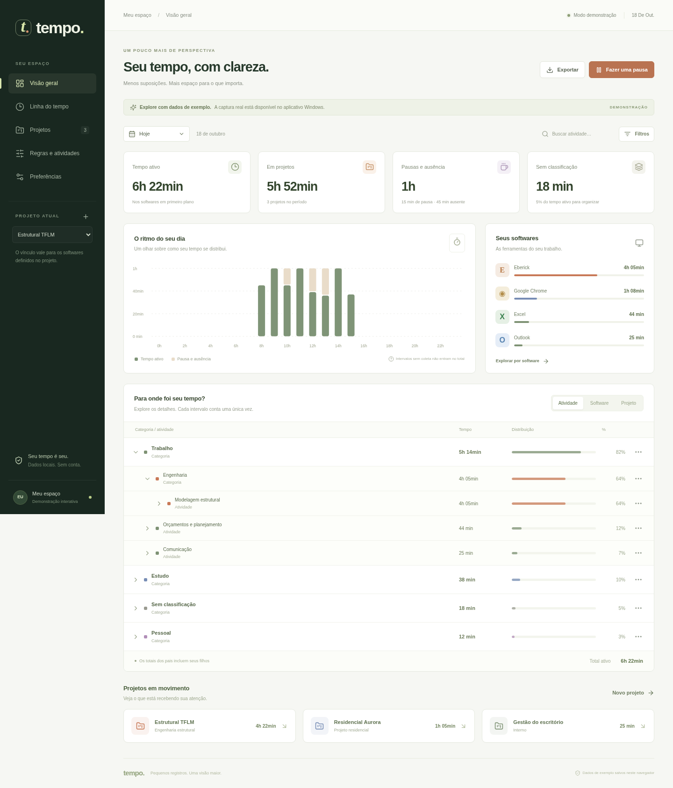

# Tempo

Rastreador pessoal de tempo para Windows. Organize o histórico em árvore e explore os mesmos intervalos por atividade, software ou projeto.

**Download da versão de teste:** [Instalador Windows x64](https://github.com/engjeanfreitas/gpt/releases/download/v0.1.1/Tempo-0.1.1-windows-x64-setup.exe) · [ZIP portátil](https://github.com/engjeanfreitas/gpt/releases/download/v0.1.1/Tempo-0.1.1-windows-x64-portable.zip) · [Página da versão](https://github.com/engjeanfreitas/gpt/releases/tag/v0.1.1).

Esta distribuição não tem assinatura de código e ainda requer os testes de captura e áudio em um Windows real. As [notas da versão](docs/RELEASE-NOTES-v0.1.1.md) descrevem recursos e limites.

Esta primeira versão inclui dashboard, timeline, projetos com estimativa de horas, regras reprocessáveis, atribuições manuais, nomes amigáveis, categorias hierárquicas, exportação CSV e pausa configurável com contador, notificação e alarme.



## Experimentar a interface

Requer Node.js 22.12+ (validado com Node 24).

```sh
npm ci
npm run dev
```

A versão de navegador usa **dados de exemplo**, identificados na tela, e salva edições no armazenamento do próprio navegador. Ela não monitora os aplicativos do computador. O contador exige que a página permaneça aberta; o comportamento independente do dashboard pertence ao aplicativo desktop.

## Executar no Windows

Requer Windows 10/11, Node.js, Rust estável com a toolchain MSVC, Microsoft C++ Build Tools com a carga “Desktop development with C++”, Windows SDK e WebView2 Runtime. Windows 11 normalmente já inclui o WebView2. A captura não requer administrador por padrão.

```powershell
npm ci
npm run desktop:dev
```

Para gerar o instalador:

```powershell
npm run desktop:build
```

O instalador NSIS será gerado em `src-tauri/target/release/bundle/nsis/`. A primeira distribuição não possui certificado de assinatura de código. O Windows pode solicitar confirmação ao executar um instalador sem reputação estabelecida.

O workflow `.github/workflows/checks.yml` executa testes e build no Windows a cada push em `main`; os resultados ficam na aba Actions do repositório.

## Usar projetos e regras

### Linha do tempo sem excesso de itens

Trocas de tela com menos de cinco minutos ficam nos detalhes de um bloco. Uma mudança de cinco minutos ou mais inicia outro bloco; retornar à mesma janela após consultas curtas mantém o bloco anterior. Pausas, ausência, lacunas entre registros e dias diferentes delimitam os blocos. Sequências só com trocas curtas aparecem como **Mudanças rápidas**.

Por exemplo, Eberick por 30 min → navegador por 2 min → Eberick por 20 min forma um bloco de 52 min, mas o dashboard continua atribuindo 50 min ao Eberick e 2 min ao navegador, em suas próprias categorias e projetos. O agrupamento é apenas visual: não modifica a coleta, o banco ou os totais. Abra o bloco para editar um intervalo específico ou marque **Mostrar todos os intervalos**. A atribuição atua no registro original completo, inclusive quando a visualização o recorta no limite do dia ou do período selecionado.

### Atribuir um projeto

1. Crie o projeto **Estrutural TFLM** e informe `eberick.exe` na lista de softwares da sessão.
2. Selecione o projeto atual na barra lateral. Enquanto o Eberick estiver em primeiro plano, os intervalos elegíveis serão vinculados ao TFLM.
3. Para reconhecer o projeto automaticamente, crie uma regra combinando `eberick.exe` e título contendo `TFLM`, **se o programa expuser esse nome na janela**. O executável sozinho não distingue projetos diferentes.
4. Abra uma linha da árvore ou da timeline para atribuir projeto/atividade a intervalos passados. Renomear não altera os identificadores ou durações.

Cada registro possui uma atividade principal e um projeto principal. Atividade e projeto são resolvidos separadamente: correção manual, regra de maior prioridade e contexto do registro. Empates de regras usam o identificador em ordem estável; a prévia alerta sobre conflitos. Uma categoria padrão do software pode organizar registros ainda sem atividade.

Pais da árvore incluem os filhos; o total geral soma apenas os intervalos ativos. O filtro de projeto/categoria é aplicado ao tempo atribuído, portanto pausas e ausência sem projeto deixam de aparecer quando esses filtros estão ativos.

## Pausa e coleta em segundo plano

- Fechar o dashboard **destrói a WebView e mantém o processo da bandeja**. Reabra pelo ícone. Para parar o aplicativo, use **Encerrar Tempo** na bandeja.
- A pausa interrompe a captura de contexto e separa sua duração das horas de trabalho.
- O vencimento emite um aviso visual e um toque configurável, mesmo com o dashboard fechado.
- Por padrão, a coleta aguarda **Continuar**. A opção de retomada automática respeita ausência e bloqueio.
- O contador e seu vencimento persistem após reinício. Se o computador dormir, o aviso é verificado ao voltar; o aplicativo não desperta o computador para alarmar.
- O tooltip da bandeja exibe o tempo restante. Atalhos fixos de 5 e 15 minutos ficam na bandeja; os favoritos configuráveis e a duração personalizada ficam no dashboard.
- Ative **Iniciar com o Windows** nas preferências para abrir na bandeja no próximo login.

A captura consulta a janela em primeiro plano a cada segundo. Bloqueio de sessão, ausência e suspensão interrompem o tempo ativo. A tolerância de ausência (padrão: três minutos) conta como tempo ativo até o limite; não há retroação à última entrada. Falhas ou saltos de mais de cinco segundos são intervalos sem coleta, nunca preenchidos como trabalho. Leitura e reuniões sem entrada podem exigir aumentar a tolerância ou corrigir a classificação; não há captura de atenção ou detecção garantida de reuniões.

## Dados e privacidade

O app desktop usa SQLite em `%LOCALAPPDATA%\com.tempo.desktop\tempo.sqlite` (caminho resolvido pela API de diretórios do Tauri). Backups ficam na subpasta `backups` e incluem configurações e histórico concluído; uma pausa em andamento também é preservada no estado de execução.

Não há conta, backend remoto, telemetria, screenshots ou registro do conteúdo digitado. Aplicativos e termos excluídos são filtrados antes de persistir seu contexto. Títulos de janela podem conter dados sensíveis: configure exclusões conforme necessário. O banco não é criptografado nesta versão; permanece protegido pelas permissões da conta e do dispositivo.

Observações iguais são agrupadas, com checkpoint a cada cinco segundos e gravação ao mudar de contexto ou sair. Um encerramento abrupto pode perder os últimos cinco segundos. A gravação usa WAL, parâmetros SQL e transações nas operações de exclusão. A retenção é aplicada na abertura, na mudança de preferências e periodicamente.

O botão de exclusão apaga o período selecionado, independentemente dos filtros de projeto/categoria. Backups e arquivos exportados anteriormente não são apagados automaticamente. Para restaurar um backup SQLite, encerre o Tempo e substitua o banco com cuidado; faça antes uma cópia do banco atual e mantenha os arquivos WAL/SHM somente da mesma instância encerrada. Não há assistente de restauração nesta versão.

## Atualizar o aplicativo

Encerre o Tempo pela bandeja e execute o instalador da nova versão, com o mesmo usuário e local de instalação. Não é preciso desinstalar manualmente; histórico e configurações ficam no diretório de dados separado. A versão 0.1.1 mantém o mesmo formato do banco. Se optar por desinstalar, não marque a exclusão dos dados do aplicativo. A distribuição portátil é atualizada substituindo os arquivos extraídos com o programa encerrado.

Regras, categorias, nomes, projetos e preferências têm efeito imediato, sem reinstalação. Mudanças no código exigem uma nova versão instalada; o Tempo ainda não possui atualizador automático.

## Validação

```sh
npm test
npm run build
npx playwright install chromium
npm run test:e2e
cargo test --manifest-path src-tauri/Cargo.toml --lib --locked
```

No ambiente de desenvolvimento que já oferece Chromium, o Playwright usa `/usr/bin/chromium`. Em outros ambientes usa seu navegador instalado pelo Playwright. `PLAYWRIGHT_CHROMIUM_EXECUTABLE` permite informar um caminho alternativo.

Os testes cobrem totais sem duplicação, reclassificação, atribuição de projeto, regras, persistência da pausa, vencimento, retomada, exclusões e layout móvel. A captura de APIs do Windows, o som real, as notificações e o início no login exigem os ensaios descritos em [Validação no Windows](docs/VALIDACAO-WINDOWS.md). Números de CPU e RAM ainda precisam ser medidos no aplicativo instalado.

## Limites desta versão

- O coletor básico registra software e título. **Não há extensão de navegador ainda**; regras por domínio só funcionam se o evento tiver domínio de uma fonte confiável. O programa não infere domínio a partir de um título.
- Não há importação de ActivityWatch ou ProcrastiTracker, sincronização, análise por IA, cobrança ou múltiplos dispositivos.
- A interface carrega o histórico retido em memória para classificar e agregar. Grandes bases exigirão consultas e agregações incrementais.
- O motor inicial usa igualdade de executável/domínio e texto contido no título; não expõe RegEx ou escopos de vigência por data. Regras se aplicam a todo o histórico disponível, com correções manuais prioritárias.
- Para dividir um intervalo automaticamente consolidado, ainda é necessário aprimorar o editor. A atribuição atual atua sobre intervalos completos selecionados.

A [pesquisa e proposta original](docs/PESQUISA-E-PROPOSTA.md) inclui funcionalidades futuras; a lista acima descreve os limites do código desta versão.
