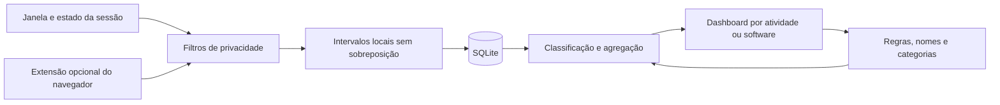

Pesquisa para um rastreador pessoal de tempo no Windows

Consulta realizada em 18/10/2026. O objetivo é combinar captura automática em segundo plano, árvore de atividades e um dashboard em que a pessoa consiga corrigir nomes e agrupamentos com poucos cliques. Este documento contém pesquisa e proposta; nenhuma aplicação foi implementada ou executada.

A recomendação é preservar duas ideias: a navegação hierárquica do ProcrastiTracker e a separação entre coleta e análise do ActivityWatch. O diferencial deve ser a facilidade de transformar registros difíceis de interpretar em atividades reconhecíveis, com regras explícitas, histórico reclassificável e alternância entre atividade e software.

A pesquisa usou documentação, código e exemplos oficiais disponíveis no GitHub. Os sites strlen.com, docs.activitywatch.net e learn.microsoft.com recusaram acesso pela política de rede deste ambiente; seus materiais disponíveis nos repositórios oficiais foram consultados. Para ManicTime, RescueTime e Rize, as fontes acessíveis são integrações oficiais, que permitem confirmar partes do modelo de dados e das funcionalidades, mas não equivalem a testar o produto inteiro. Não houve comparação prática dos executáveis, medição de desempenho no Windows, validação de preços ou levantamento exaustivo de planos comerciais. Recursos vistos na branch de desenvolvimento são diferenciados de recursos documentados em uma versão publicada.

**O ProcrastiTracker fornece a referência mais direta para a árvore.** O README descreve um aplicativo pequeno, na bandeja do Windows, que consulta aplicação e URL a cada dez segundos e grava os resultados num banco próprio em árvore. O intervalo é configurável no código. A implementação usa C++ e controles Win32. [1]

Seu manual distribuído no próprio repositório explica como essa árvore nasce: o primeiro nível é o executável; em navegadores, pode haver um nível de domínio; em seguida, partes do título são divididas por separadores como ` - `, ` | `, ` : `, ` > ` e barra invertida. O código confirma a concatenação de executável, domínio e título, seguida da divisão em nós. [2–4]

Portanto, a hierarquia é uma interpretação estrutural do que o aplicativo expõe no título. Ela pode revelar documento, projeto ou pasta quando o título contém essas informações. Não identifica, por si só, a intenção da pessoa nem garante reconhecer um projeto em qualquer software. Um título como `relatorio.xlsx - Excel` pode ser útil; um título genérico como `Página inicial` fornece pouco contexto.

O manual também documenta tags herdadas: marcar um nó define a classificação de seus descendentes, até que um descendente receba uma classificação própria. É possível renomear tags, filtrar por período e tag, exportar HTML e acompanhar ausência e semi-inatividade. O código inspecionado também contém operações de mesclagem de nós. [2, 5]

Essa herança é valiosa para o app proposto: definir uma categoria padrão para um software e criar exceções para determinados documentos ou sites. Entretanto, um app inteiro não deve receber uma interpretação universal de produtividade: o mesmo navegador serve para trabalho, estudo e lazer.

Há limites importantes. A captura de URL contém caminhos específicos para navegadores, DDE e alternativas para Chromium; os próprios comentários apontam dificuldades de compatibilidade. Não seria prudente prometer suporte universal copiando esse mecanismo. O banco é um formato próprio comprimido, com estatísticas por nó/dia e dados de minuto, não o mesmo modelo de intervalos do ActivityWatch. A documentação do formato declara uma versão antiga; uma importação real precisaria acompanhar o leitor atual e ser testada com arquivos reais. Não se deve prometer reconstruir uma timeline precisa quando a informação original já foi agregada ou descartada. [3, 6]

As alegações de baixo consumo vêm da documentação do autor, não de um benchmark realizado nesta pesquisa. Tampouco cabe classificar o projeto como abandonado apenas porque o README menciona Visual Studio 2015: o checkout consultado contém alterações de 2026.

**O ActivityWatch já cobre uma parcela considerável do pedido.** Ele coleta dados com componentes separados: watcher de janela, watcher de ausência e extensão de navegador. Os eventos são armazenados por origem em buckets, e a interface consulta o servidor local. Um evento possui início, duração e dados; heartbeats juntam observações consecutivas iguais para reduzir gravações e volume. [7–8]

O watcher de janela registra aplicação e título; o de navegador pode fornecer URL, título e sinais como áudio. O watcher de ausência informa presença/ausência. Nos fontes consultados, a configuração padrão da janela usa consulta de um segundo; a de ausência usa três minutos de tolerância e consulta de cinco segundos. Esses números descrevem os fontes inspecionados, não precisão garantida de ponta a ponta. [9]

O ActivityWatch já tem categorias e subcategorias, regras, cores, visão de aplicativos e timeline. O guia de categorização descreve regras RegEx e categorias sem regra, com preferência pela categoria mais profunda. O código atual é mais amplo: permite selecionar campos, atribuir prioridade e reaplicar regras sem alterar os dados de origem. É importante não vender essas funcionalidades como ausentes no concorrente. [10]

Há divergências entre páginas da documentação: o guia antigo de categorização ainda fala em limitações de URL, enquanto o código mais recente possui seleção de campos; uma página antiga trata filtros de privacidade como futuros, enquanto o changelog e o watcher atual já documentam filtros. A conclusão segura é verificar a versão concreta durante uma avaliação prática, em vez de generalizar uma página antiga ou uma branch recente para todas as instalações.

O changelog oficial documenta a versão 0.14.0 como publicada em 06/10/2026; sua tag e página de release também foram localizadas. Entre as mudanças descritas estão melhorias na timeline, períodos personalizados, conjuntos de categorias e uma opção de aplicativo desktop com Tauri. O aplicativo clássico continua como padrão nessa documentação; a alternativa Tauri é apresentada como menos testada em uso real. [11]

O aw-tauri incorpora o servidor Rust, oferece bandeja, inicialização no login, instância única e gerenciamento dos watchers. Portanto, comparar apenas o bundle clássico Python/Qt com um futuro produto Rust produziria uma avaliação incompleta. O aw-tauri precisa entrar no teste de consumo. O README não fornece um orçamento de memória que possa ser adotado como medição independente. [12]

O modelo de armazenamento é local. A política consultada também descreve uma funcionalidade opcional de resumo por IA que envia um resumo ao provedor escolhido quando acionada. Para o nosso produto, a proposta inicial é funcionar offline sem esse envio. Armazenamento local não significa criptografia automática: a própria documentação de segurança distingue armazenamento, acesso à API e criptografia opcional em determinadas compilações. [13]

**As demais ferramentas ajudam a selecionar funcionalidades sem ampliar demais o escopo.** A tabela combina referências diretamente inspecionadas. As limitações referem-se ao encaixe no pedido, não a uma classificação geral de qualidade.

| Ferramenta | O que a fonte consultada permite afirmar | Ideia útil para o produto | Limite para este pedido |
|---|---|---|---|
| ProcrastiTracker | Captura automática, árvore por executável/título/domínio, tags herdadas | Árvore expansível e classificação de descendentes | Contexto depende do título; captura de URL exige cuidado |
| ActivityWatch | Watchers, dados locais, categorias hierárquicas, dashboard, API | Histórico reclassificável e separação da coleta | A experiência de edição precisa ser avaliada contra o fluxo desejado |
| arbtt | Captura periódica em segundo plano; regras aplicadas ao consultar todo o histórico; aliases | Melhorar uma regra e corrigir os dados anteriores | Configuração textual e relatórios de linha de comando no projeto-base [14] |
| ManicTime | Plugins oficiais separam tags, timelines e captura de dados de documentos; há API cloud e on-premises | Distinguir uso do aplicativo, documento e classificação | As fontes acessíveis não validam todos os recursos ou planos da interface atual [15] |
| RescueTime | Integração oficial expõe atividade, projetos, tarefas, padrões de produtividade e sessões de foco | Resumos compreensíveis e revisão do período | A integração não confirma funcionamento offline nem toda a interface atual [16] |
| Rize | Integração oficial descreve rastreamento automático e análise por cliente, projeto, tarefa, label e aplicativos | Múltiplas formas de agrupar a mesma base de tempo | Recursos de equipe, margem e sugestões por IA ampliariam demais o MVP [17] |
| WakaTime / Wakapi | Plugins fornecem contexto do editor; cliente pode mapear projetos e enviar heartbeats; Wakapi é um backend compatível que pode ser hospedado pela pessoa | Contexto específico é mais confiável quando vem do próprio software | Não substitui, por si só, um coletor geral do desktop [18] |
| Super Productivity | Tarefas, projetos, tags, planejamento, foco e controle de tempo | Projetos e atividades com nomes compreensíveis | É uma referência de planejamento; sua existência não comprova captura passiva equivalente do desktop [19] |
| Kimai | Controle de horas com clientes, projetos, tags, relatórios e faturamento | Agrupamentos consistentes e exportação | Requer infraestrutura de aplicação web e banco; escopo mais amplo que um utilitário pessoal [20] |

A lição do arbtt é especialmente alinhada ao pedido: a documentação afirma que as regras são aplicadas novamente aos dados registrados, de modo que melhorar a classificação também melhora os relatórios passados. É um bom princípio para o nosso motor. Aliases de software e classificação de atividade devem ser mecanismos separados.

**Software, atividade, categoria e projeto devem ser dimensões distintas.** O software informa qual programa estava em primeiro plano. A atividade representa o significado atribuído àquele intervalo. A categoria organiza atividades numa hierarquia. O requisito adicional de acompanhar o projeto estrutural TFLM torna projeto uma dimensão própria desde o MVP: um projeto pode reunir várias atividades e vários softwares, e um software pode ser usado em projetos diferentes. Nome, categoria e projeto terão identificadores independentes para permitir renomear sem perder associações históricas.

Exemplo ilustrativo, sem dados coletados da pessoa:

| Registro observado | Software mostrado | Atividade reconhecível | Caminho da categoria |
|---|---|---|---|
| `EXCEL.EXE`, título contém `Cliente Alfa` | Excel | Preparar orçamento | Trabalho › Cliente Alfa › Orçamento |
| `chrome.exe`, domínio `docs.python.org` | Chrome | Consultar documentação | Estudo › Programação |
| `chrome.exe`, domínio `youtube.com`, título contém nome de um curso | Chrome | Assistir ao curso | Estudo › Formação |
| `chrome.exe`, outro contexto sem regra | Chrome | Atividade sem classificação | Sem classificação |

Os domínios pressupõem extensão ou outra fonte confiável. A presença de um site no título não equivale à observação de seu domínio real. Uma regra que reconhece o nome de um curso é apenas uma heurística; deve permanecer visível e editável.

A árvore por atividade poderia aparecer assim:

```text
Trabalho
└── Cliente Alfa
    ├── Orçamento
    │   └── Preparar orçamento [Excel]
    └── Pesquisa
        └── Consultar referências [Chrome]
Estudo
├── Programação
│   └── Consultar documentação [Chrome]
└── Formação
    └── Assistir ao curso [Chrome]
Sem classificação
```

Na visualização por software, os mesmos intervalos seriam reorganizados como `Excel › atividades/documentos` e `Chrome › sites › atividades`. Uma atividade também pode reunir intervalos de softwares diferentes. A alternância muda o agrupamento e preserva filtros e totais.

Cada intervalo terá uma atividade principal e um caminho principal de categoria. O tempo dos pais inclui o dos filhos; não se somam novamente pai e filho ao total geral. Tags opcionais podem se sobrepor, com essa sobreposição explicitada. Nos totais principais, navegador e aplicativo não são tempos independentes: dez minutos de Chrome em primeiro plano continuam sendo dez minutos, mesmo quando a extensão informa o site.

**A edição no próprio dashboard é a principal oportunidade de simplificação.** Proponho quatro operações que a interface explique separadamente:

1. Renomear software: mudar `EXCEL.EXE` para `Excel`, preservando sua identidade técnica e os dados registrados.
2. Renomear atividade: mudar o rótulo que agrega determinados registros; várias regras podem apontar para a mesma atividade.
3. Editar regra: alterar quais condições identificam a atividade, como software, domínio ou texto do título. O nome da regra pode ser amigável sem mudar o critério.
4. Mover ou agrupar categoria: reorganizar a árvore usando identificadores estáveis; dois nomes iguais não devem fundir itens automaticamente.

Ao selecionar um item, o painel lateral mostraria software, contexto observado, atividade, categoria e a explicação da regra vencedora. A pessoa poderia criar uma regra usando aquele registro como exemplo. O editor básico usaria `é igual a`, `contém`, `começa com` e combinação de condições; RegEx ficaria numa opção avançada.

Antes de salvar, uma prévia mostraria quantos registros e quanto tempo seriam afetados no período escolhido, quais regras entram em conflito e alguns exemplos. A pessoa escolheria entre corrigir só o intervalo, aplicar uma regra a todo o histórico disponível ou aplicá-la a partir de uma data. A opção histórica pode vir selecionada para o uso pessoal, mas deve ser explícita.

A precedência proposta é: exclusões de privacidade antes de gravar; depois, na classificação, correção manual do intervalo, regras em prioridade explícita e categoria padrão do software. Empates devem ser sinalizados e resolvidos de forma determinística. Regras mais específicas podem ser sugeridas acima das genéricas. O usuário deve entender por que uma exceção vence, sem depender de uma prioridade invisível baseada apenas na profundidade da árvore.

Os registros preservados ficam separados das regras e dos nomes. Alterar uma regra invalida as agregações afetadas, recalcula os resultados e pode ser desfeito. Dados excluídos por privacidade não poderão ser recuperados por reclassificação: só se reprocessa o que foi efetivamente armazenado.

**O projeto estrutural TFLM é o exemplo de atribuição solicitado.** Um registro de três horas de uso ativo de `eberick.exe` poderá ser associado ao projeto TFLM. Esse mesmo tempo aparecerá no total do Eberick e no total do projeto, como duas formas de consultar os mesmos intervalos. Se parte do trabalho ocorrer em Excel ou num navegador, os intervalos correspondentes também poderão integrar o TFLM. Uso do programa durante uma pausa, ausência ou suspensão não será somado como trabalho ativo.

| Projeto | Software | Atividade | Tempo do exemplo |
|---|---|---|---|
| TFLM | Eberick | Modelagem estrutural | 3 horas |

A atribuição terá três caminhos: selecionar o projeto atual na bandeja/dashboard, criar regra automática a partir do contexto disponível e atribuir ou corrigir intervalos já registrados na timeline. O nome “Modelagem estrutural” é apenas ilustrativo; a pessoa pode informar a atividade real.

Uma regra automática poderá combinar `eberick.exe` com um título que contenha `TFLM`, se o Eberick de fato expuser o nome do projeto no título. Caminho de arquivo só será usado se houver uma fonte confiável; a captura básica de janela não garante esse dado. Caso o nome não esteja disponível, a seleção manual fornece o contexto. A configuração deve indicar se essa seleção vale para a janela ou para determinados softwares durante a sessão, sem atribuir programas não relacionados silenciosamente.

O executável sozinho não distingue TFLM de outro projeto estrutural aberto no mesmo programa. O projeto atual deve ficar visível e a troca precisa ser rápida. Uma regra mais específica de documento/projeto prevalece sobre o contexto geral da sessão; uma correção manual explícita prevalece sobre ambos. A ausência de evidência deixa o intervalo “Sem projeto”. A prévia da regra e o reprocessamento do histórico também se aplicam à atribuição de projeto.

Para a solicitação de configurar tempo por projeto, o requisito confirmado é acompanhar tempo real atribuído, por dia e acumulado. Como opção de planejamento, propõe-se também uma estimativa total configurável: por exemplo, estimativa de 20 horas, 3 horas registradas e saldo de 17 horas. Esse saldo é apenas a diferença para a estimativa, não uma previsão de conclusão. Pode haver alertas opcionais ao atingir um limite de horas. A estimativa não transforma o projeto num cronômetro regressivo obrigatório e não modifica o tempo real registrado.

**A pausa terá duração configurável, contagem regressiva e aviso de término.** O botão estará no dashboard e no menu da bandeja, com atalhos de duração editáveis, por exemplo 5, 10, 15 e 30 minutos, duração personalizada e opção de pausa sem prazo. Durante uma pausa temporizada, o tempo restante ficará visível; será possível prorrogar ou encerrar antecipadamente. A bandeja permitirá conferir o contador mesmo com a interface principal fechada.

Ao começar a pausa, o app encerrará o intervalo ativo, suspenderá a captura de contexto de trabalho e registrará somente início, fim e motivo opcional da pausa. A pausa não somará horas ao projeto ou à atividade. O contexto do projeto será preservado para a retomada, com o escopo escolhido pelo usuário. Pausa explícita será um estado distinto da ausência detectada por inatividade, para evitar dupla contagem.

No vencimento, haverá notificação visual e alarme sonoro configurável, com opções para continuar ou prorrogar. A proposta inicial é exigir “Continuar” para retomar a captura; uma configuração poderá permitir retomada automática ao terminar o contador. Essa escolha deve ficar explícita na interface. O vencimento programado e a retomada real serão registrados separadamente: se a pessoa voltar depois, esse intervalo adicional continuará sendo pausa, sem inventar tempo de trabalho.

Volume, som e habilitação do aviso sonoro poderão ser configurados, com botão para testar o alarme. O funcionamento precisa ser testado com o dashboard fechado e com as configurações de áudio/notificação do Windows; áudio silenciado ou notificações bloqueadas pelo sistema limitam o aviso perceptível. O estado da pausa e o horário de término serão persistidos para recuperação após reinício do app. Se o computador estiver suspenso no vencimento, o aviso acontecerá na retomada; alarmar enquanto o computador dorme exigiria outro escopo de integração com o sistema.

**O dashboard inicial precisa responder a poucas perguntas com clareza.** Ele mostraria período selecionado; alternância `Por atividade | Por software | Por projeto`; filtros de categoria, projeto e software; indicadores de tempo ativo, pausa, ausência e tempo sem classificação; um ranking horizontal; uma timeline do dia; e uma tabela em árvore com duração e percentual. “Sem projeto” e “Sem classificação de atividade” serão estados independentes: atribuir TFLM a um intervalo não significa automaticamente saber qual atividade foi realizada.

O ranking ajuda a comparar durações; a árvore permite aprofundar; a timeline explica quando o tempo aconteceu. Gráficos de pizza, treemap e sunburst podem ser avaliados depois, se ajudarem uma tarefa concreta. Não são necessários para a primeira versão. Os percentuais devem indicar o denominador, por exemplo, porcentagem do tempo ativo filtrado.

| Ação na tela | Resultado esperado |
|---|---|
| Escolher um período | Atualiza indicadores, gráficos e árvore juntos |
| Alternar atividade/software | Reagrupa os mesmos dados sem mudar o total |
| Clicar numa categoria | Mostra seus filhos e permite voltar pelo caminho |
| Selecionar uma linha | Abre contexto e edição no painel lateral |
| Corrigir uma regra | Mostra impacto e depois atualiza os relatórios |
| Abrir “Sem classificação” | Apresenta os itens que mais consomem tempo primeiro |
| Selecionar TFLM | Mostra seu tempo no período, acumulado e distribuição entre softwares e atividades |
| Atribuir projeto a um intervalo | Atualiza o projeto sem modificar o total de tempo registrado |
| Iniciar pausa temporizada | Interrompe o trabalho ativo, apresenta contador e agenda o aviso |
| Terminar o contador | Emite os avisos configurados e oferece continuar ou prorrogar |

“Sem classificação” deve ser uma fila de organização, e não um erro escondido. O programa pode ser útil desde o primeiro dia com uma árvore automática e deixar a pessoa refinar os rótulos aos poucos.

**No Windows, o coletor deve rodar na sessão do usuário.** A documentação da Microsoft informa que serviços usam uma sessão não interativa e não devem ser tratados como aplicações de desktop. Um aplicativo na bandeja, iniciado no login e sem administrador por padrão, é o desenho inicial adequado. [21]

Para captura, as APIs relevantes são `GetForegroundWindow`, `GetWindowTextW` e consulta do executável do processo. `SetWinEventHook` permite receber mudanças; um mecanismo periódico de reconciliação ainda é útil para títulos que mudam e eventos perdidos. O callback precisa permanecer curto, e a thread que registra o hook precisa de um loop de mensagens. Esses requisitos são documentados pela Microsoft. [22]

`GetLastInputInfo` fornece ausência de entrada na sessão atual, não em todas as sessões. Bloqueio e desbloqueio devem ser acompanhados por notificações de sessão; suspensão e retomada, por notificações de energia. Relógio de parede não deve ser o único contador de duração. Os intervalos precisam ser encerrados ou marcados como desconhecidos em falhas, suspensão ou perda de sinal, sem preencher automaticamente o período inteiro como atividade. [23]

Há limitações que a especificação precisa assumir: processos protegidos podem não fornecer todos os campos; aplicativos modernos podem ter identidade diferente de um executável simples; duas telas visíveis continuam tendo apenas uma janela em primeiro plano; sessões remotas, jogos, controle e leitura sem teclado/mouse precisam de cenários próprios de teste.

Tempo em primeiro plano é uma aproximação de uso, não uma medição de atenção ou produtividade. Uma chamada, leitura ou vídeo pode durar muito sem entrada. Proponho limite de ausência configurável, inicialmente três minutos, mais uma opção temporária de manter atividade e correção posterior. A semântica de retroagir o início da ausência até a última interação deve ser explícita. Áudio de fundo pode ser contexto, mas não deve gerar horas adicionais sobrepostas ou manter tudo ativo indiscriminadamente.

Para sites, recomendo extensão opcional de Chrome/Edge. Ela forneceria apenas o contexto da aba ativa, usado quando o navegador estiver em primeiro plano. O transporte preferido para o produto próprio seria Native Messaging com uma ponte local e permissões restritas. Isso exige manifestos, registro no instalador e testes; não é uma funcionalidade automática do Tauri. Firefox pode entrar depois. [24]

Sem extensão, o app continua útil para software e título, com um aviso discreto sobre o limite da classificação por sites. A primeira entrega que prometer relatórios confiáveis por domínio precisa incluir e validar a extensão. Evitaria ler a barra de endereços por automação de interface como método principal, devido à dependência da estrutura de cada navegador.

**A arquitetura deve manter a captura funcionando com o dashboard fechado.** Para um produto próprio, a preferência inicial é núcleo em Rust, APIs Win32, SQLite e interface Tauri com TypeScript. O objetivo é carregar a WebView somente quando necessária e descarregá-la ao fechar o dashboard; simplesmente esconder a janela não demonstra economia de memória. O comportamento precisa ser medido. C# com uma versão .NET LTS e interface WPF continua uma alternativa razoável se familiaridade com Windows reduzir o custo de manutenção. A escolha não deve ser justificada por números de RAM ainda não medidos.



SQLite permite evitar um servidor de banco externo. O projeto deve armazenar intervalos de início/fim e contexto permitido, identidade de software, atividades, categorias, projetos, regras versionadas e correções manuais. Pausas terão início, vencimento opcional, retomada real e política de retomada; estimativas opcionais ficarão associadas ao projeto. Agregações diárias podem ser descartadas e recalculadas. Instantes serão gravados em UTC, com metadados suficientes para aplicar uma política explícita de fuso; os dias serão calculados na visualização escolhida, inclusive quando houver mudança de horário ou eventos cruzando meia-noite.

Observações consecutivas iguais serão consolidadas. Títulos dinâmicos, cronômetros e porcentagens podem produzir muitos fragmentos; normalizadores opcionais por software ajudam, mas não devem remover o nome do documento ou outras partes essenciais. Gravações serão agrupadas com checkpoints curtos e um limite documentado de perda em encerramento abrupto. O fechamento normal deve concluir a gravação pendente.

Os dados e backups precisam de controle de acesso por usuário. Excluir aplicativos, títulos ou domínios sensíveis deve acontecer antes de persistir. A interface deve oferecer pausa, exclusão por período, retenção e exportação. Títulos podem conter dados privados, mesmo sem capturar a tela. Sessões privadas só podem ser excluídas com garantia quando há sinal confiável; um título genérico de janela não garante detectar toda navegação anônima. Não incluiria captura de tela, conteúdo de teclas ou telemetria no MVP.

**Reaproveitar o ActivityWatch merece uma avaliação antes de escrever outro coletor.** Há três caminhos:

| Caminho | Benefício | Custo ou risco |
|---|---|---|
| Dashboard próprio sobre dados/API do ActivityWatch | Valida o fluxo com um coletor existente | Empacotamento e execução continuam dependentes do ActivityWatch; regras próprias precisam de armazenamento e limites claros |
| Adaptar aw-tauri/aw-webui | Bandeja, API e estrutura já existem | Manutenção do fork, atualização das dependências e obrigações de licença |
| App próprio com coletor Win32 e SQLite | Controle sobre instalação, lifecycle, regras e escopo | Mais trabalho para acertar captura, ausência, navegador e recuperação |

A recomendação prática é usar exportações do ActivityWatch para validar a modelagem e o dashboard e comparar o aw-tauri com o orçamento de recursos escolhido. Só decidir pelo coletor novo depois dessa avaliação curta. Se independência e consumo exigirem app próprio, o núcleo Rust descrito acima é uma boa hipótese. Importação de ActivityWatch pode continuar útil independentemente da decisão. Não faria da leitura direta do banco de outro programa uma integração obrigatória; exportação ou API documentada são limites mais estáveis.

Quanto a reaproveitamento de código, o ProcrastiTracker declara Apache 2.0; os componentes ActivityWatch inspecionados usam MPL 2.0. Distribuir modificações requer respeitar as obrigações aplicáveis, inclusive avisos e disponibilização dos arquivos cobertos quando exigida. Isso não autoriza reutilizar marca ou elementos proprietários de terceiros. A licença de um plugin aberto de produto comercial também não é a licença do produto inteiro. A decisão deve ser registrada antes de incorporar código.

**“Leve” precisa virar um critério medido.** Ainda não há números comparativos obtidos nesta pesquisa. Proponho estes objetivos iniciais, a ajustar após o primeiro teste em máquina Windows de referência:

| Critério | Objetivo proposto e método |
|---|---|
| Captura em segundo plano | Funciona após fechar a interface e após login/reinício |
| CPU | Buscar média abaixo de 0,5% da CPU total, com dashboard fechado; medir repouso e uso real separadamente |
| Memória | Buscar até 50 MB para o núcleo de captura/bandeja; contabilizar e publicar separadamente ponte e todos os subprocessos da WebView |
| Interface | Buscar consulta de 30 dias em até 1 segundo com um volume de referência previamente definido; medir primeira consulta e repetição |
| Confiabilidade | Reconhecer bloqueio, suspensão e lacunas; não somar contextos sobrepostos |
| Armazenamento | Medir crescimento diário, fragmentação e retenção com títulos reais, sem extrapolar só a partir de uma simulação favorável |
| Privacidade | Confirmar que exclusões não chegam ao banco, backups ou logs de diagnóstico |

Os números são metas de engenharia para o nosso app, não resultados medidos nem promessas de que uma stack os atende automaticamente. O ensaio deve incluir o pacote inteiro, não apenas um processo escolhido para parecer menor.

**O MVP deve ser delimitado pelo fluxo central.** Entram captura automática por usuário, bandeja e início no login; presença e bloqueio; árvore com herança e exceções; nomes amigáveis; regras simples com prévia e aplicação ao histórico; projetos com seleção manual, regras e atribuição retroativa; alternância por atividade/software/projeto; período e filtros; ranking, timeline e árvore; armazenamento local; pausa configurável com contador e alarme, exclusões, exportação e backup. Estimativa e limite de horas por projeto são opções de planejamento propostas. A extensão Chrome/Edge entra na entrega que incluir domínio confiável. Importação de ActivityWatch é uma opção útil para experimentar o fluxo com histórico existente.

Ficam para depois: sincronização entre dispositivos, equipe e faturamento, celular, bloqueio de distrações, Pomodoro, IA para classificação, captura de tela e plugins específicos de cada software. Importação completa do formato ProcrastiTracker também exige uma etapa própria, com arquivos reais e preservação explícita da resolução disponível.

Antes de chamar uma primeira versão de utilizável, os cenários de aceitação devem comprovar: alternar duas janelas gera durações coerentes; trocar uma regra muda atividade/categoria e preserva o total; mover uma categoria preserva seus filhos; exceção específica vence a regra geral; navegador sem foco não gera dupla contagem; bloqueio e suspensão interrompem o tempo ativo; falha deixa uma lacuna explícita; exclusão não grava dados; percentuais continuam consistentes ao filtrar; e o coletor permanece ativo com o dashboard encerrado.

Os requisitos adicionais exigem comprovar também: três horas de Eberick atribuídas ao TFLM aparecem como três horas no projeto; dividir esse período entre projetos preserva o total; mudar o nome do TFLM preserva suas associações; pausa não aumenta horas do projeto; o contador pode ser prorrogado e encerrado; o aviso funciona com o dashboard fechado; exigir confirmação mantém a captura pausada até “Continuar”; a opção de retomada automática respeita ausência e bloqueio; e reinício ou suspensão não perdem o estado da pausa nem duplicam o aviso de término.

O próximo passo recomendado é definir um wireframe do dashboard e um conjunto pequeno de exemplos de títulos/softwares, seguido da avaliação prática do ActivityWatch/Tauri no Windows. Isso permite escolher a base técnica com evidência antes de desenvolver o produto completo.

As fontes abaixo sustentam as constatações. Referências de branch podem mudar; os commits dos repositórios clonados estão registrados em `sources/repositories.json`. Fontes avulsas consultadas foram preservadas em `sources/` para rastreabilidade.

1. [ProcrastiTracker: README e licença](https://github.com/aardappel/procrastitracker/blob/6400c8fcfed203e22d792e39ee8a580ff2df3f04/readme.md).
2. [ProcrastiTracker: manual incluído, árvore e tags](https://github.com/aardappel/procrastitracker/blob/6400c8fcfed203e22d792e39ee8a580ff2df3f04/PT/README.html).
3. [ProcrastiTracker: captura de aplicação, título e domínio](https://github.com/aardappel/procrastitracker/blob/6400c8fcfed203e22d792e39ee8a580ff2df3f04/src/timercallback.h).
4. [ProcrastiTracker: construção da árvore](https://github.com/aardappel/procrastitracker/blob/6400c8fcfed203e22d792e39ee8a580ff2df3f04/src/nodedb.h).
5. [ProcrastiTracker: herança no modelo de nós](https://github.com/aardappel/procrastitracker/blob/6400c8fcfed203e22d792e39ee8a580ff2df3f04/src/node.h) e [operações da interface](https://github.com/aardappel/procrastitracker/blob/6400c8fcfed203e22d792e39ee8a580ff2df3f04/src/statview.h).
6. [ProcrastiTracker: descrição do formato](https://github.com/aardappel/procrastitracker/blob/6400c8fcfed203e22d792e39ee8a580ff2df3f04/PT/file_format.txt).
7. [ActivityWatch: arquitetura](https://github.com/ActivityWatch/docs/blob/3f071231aeb954e2f8c25c348108af26ea2c9dea/src/architecture.rst).
8. [ActivityWatch: eventos e heartbeats](https://github.com/ActivityWatch/docs/blob/3f071231aeb954e2f8c25c348108af26ea2c9dea/src/buckets-and-events.rst).
9. [ActivityWatch: configuração de janela](https://github.com/ActivityWatch/aw-watcher-window/blob/aebd113f0aec459edce5acb1194b9f7e5bd749ff/aw_watcher_window/config.py), [configuração de ausência](https://github.com/ActivityWatch/aw-watcher-afk/blob/2762612e1b058db66c86c37803de12506b102b9b/aw_watcher_afk/config.py) e [watcher web](https://github.com/ActivityWatch/aw-watcher-web).
10. [ActivityWatch: guia de categorização](https://github.com/ActivityWatch/docs/blob/3f071231aeb954e2f8c25c348108af26ea2c9dea/src/features/categorization.rst) e [motor atual de classificação](https://github.com/ActivityWatch/aw-core/blob/28c3acf047b225f90592e1c47c8ec2596612d70b/aw_transform/classify.py).
11. [ActivityWatch: notas da versão 0.14.0](https://github.com/ActivityWatch/docs/blob/3f071231aeb954e2f8c25c348108af26ea2c9dea/src/changelog/v0_14.rst) e [release](https://github.com/ActivityWatch/activitywatch/releases/tag/v0.14.0).
12. [ActivityWatch: aw-tauri](https://github.com/ActivityWatch/aw-tauri).
13. [ActivityWatch: privacidade](https://github.com/ActivityWatch/docs/blob/3f071231aeb954e2f8c25c348108af26ea2c9dea/src/privacy.rst) e [segurança](https://github.com/ActivityWatch/docs/blob/3f071231aeb954e2f8c25c348108af26ea2c9dea/src/security.rst).
14. [arbtt: README](https://github.com/nomeata/arbtt/blob/dd8ab8a297aba9d2d5fff2449b8800c52abdf058/README.md), [manual e aplicação retroativa](https://github.com/nomeata/arbtt/blob/dd8ab8a297aba9d2d5fff2449b8800c52abdf058/doc/arbtt.xml) e [exemplos de regras](https://github.com/nomeata/arbtt/blob/dd8ab8a297aba9d2d5fff2449b8800c52abdf058/categorize.cfg).
15. [ManicTime: plugins oficiais](https://github.com/manictime/manictime-client-plugin-example) e [cliente da API](https://github.com/manictime/manictime-api-client).
16. [RescueTime: integração oficial](https://github.com/RescueTime/rescuetime-claude-plugin).
17. [Rize: integração oficial](https://github.com/rize-io/mcp) e [biblioteca de metadados de janelas](https://github.com/rize-io/get-windows).
18. [WakaTime CLI](https://github.com/wakatime/wakatime-cli), [configuração e privacidade](https://github.com/wakatime/wakatime-cli/blob/c4f969a60b2c3210ce994ec47d3ac7245bbe0450/USAGE.md) e [Wakapi](https://github.com/muety/wakapi).
19. [Super Productivity](https://github.com/super-productivity/super-productivity).
20. [Kimai](https://github.com/kimai/kimai/blob/a3bf6f94b532332bc0846ed3da880c3e56cc85f6/README.md).
21. [Microsoft: serviços e sessão interativa](https://github.com/MicrosoftDocs/win32/blob/docs/desktop-src/Services/interactive-services.md).
22. [Microsoft: GetForegroundWindow](https://github.com/MicrosoftDocs/sdk-api/blob/docs/sdk-api-src/content/winuser/nf-winuser-getforegroundwindow.md), [GetWindowTextW](https://github.com/MicrosoftDocs/sdk-api/blob/docs/sdk-api-src/content/winuser/nf-winuser-getwindowtextw.md), [QueryFullProcessImageNameW](https://github.com/MicrosoftDocs/sdk-api/blob/docs/sdk-api-src/content/winbase/nf-winbase-queryfullprocessimagenamew.md) e [SetWinEventHook](https://github.com/MicrosoftDocs/sdk-api/blob/docs/sdk-api-src/content/winuser/nf-winuser-setwineventhook.md).
23. [Microsoft: GetLastInputInfo](https://github.com/MicrosoftDocs/sdk-api/blob/docs/sdk-api-src/content/winuser/nf-winuser-getlastinputinfo.md), [WTSRegisterSessionNotification](https://github.com/MicrosoftDocs/sdk-api/blob/docs/sdk-api-src/content/wtsapi32/nf-wtsapi32-wtsregistersessionnotification.md) e [WM_POWERBROADCAST](https://github.com/MicrosoftDocs/win32/blob/docs/desktop-src/Power/wm-powerbroadcast.md).
24. [MDN: Native Messaging](https://github.com/mdn/content/blob/main/files/en-us/mozilla/add-ons/webextensions/native_messaging/index.md).
